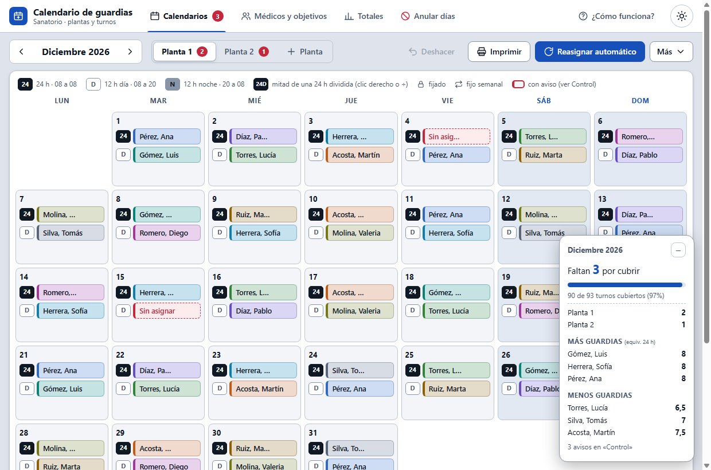
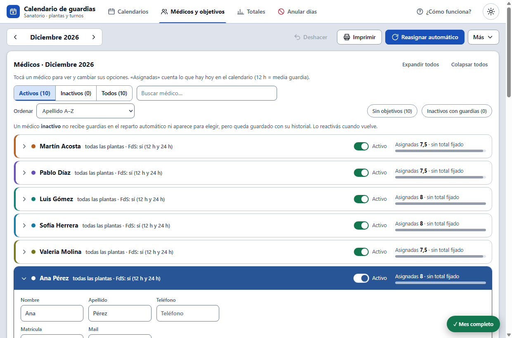
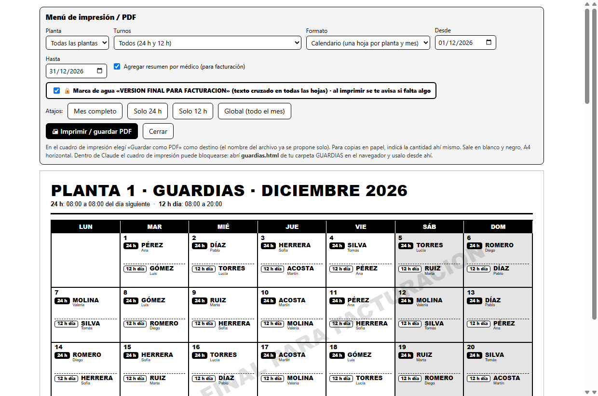
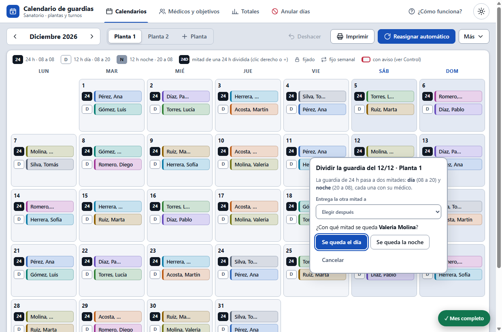
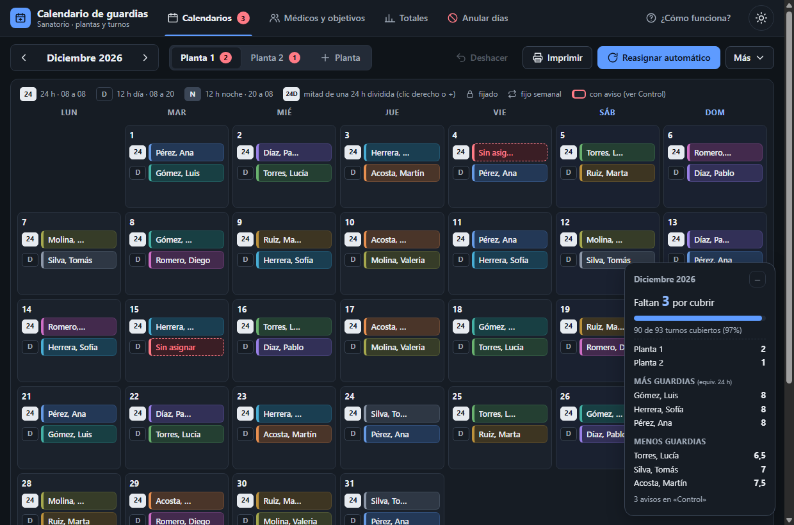
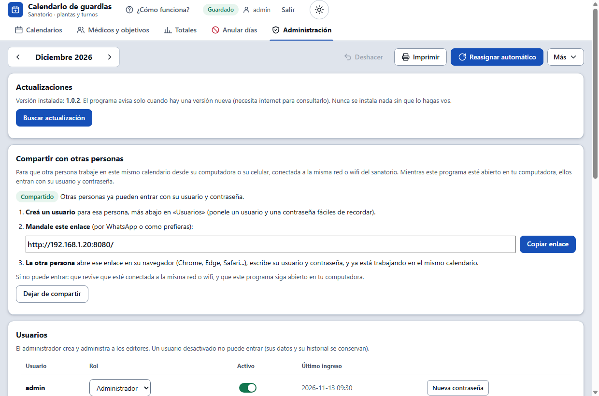

# Calendario de guardias

**Programa para armar y repartir las guardias médicas de un sanatorio**, pensado para gente que no sabe de computación: se instala con un doble clic, funciona sin internet y todos los datos quedan en la propia computadora.

> *English, in one line:* a self-contained, Spanish-language scheduling tool for hospital on-call shifts (24 h / 12 h day / 12 h night, several wards), with automatic fair distribution, rest-rule checks, a multi-user local server (SQLite) and a printable, watermarked billing report. No dependencies, no cloud.



## Qué hace

- **Reparto automático y parejo** de las guardias del mes entre todos los médicos, respetando los descansos (después de una guardia de 24 h, 24 h libres; después de una de 12 h, 12 h) **entre todas las plantas**.
- **Varias plantas** sin límite, cada una con sus turnos: 24 h, 12 h de día (08–20) y 12 h de noche (20–08), en cualquier combinación.
- **Dividir una guardia de 24 h** entre dos médicos (día y noche) con clic derecho.
- **Fichas de médicos**: en qué plantas y turnos hacen guardias, fines de semana, días que no están (fijos o fechas puntuales), cantidad de guardias que se les quiere dar, activos / inactivos con historial.
- **Control del mes**: avisa turnos sin médico, descansos que no se respetan y guardias que se pisan; permite aceptar excepciones.
- **Recordatorio flotante**: cuántos turnos faltan por cubrir, quién tiene más y quién menos guardias.
- **Totales** por médico: horas, guardias equivalentes a 24 h, fines de semana.
- **Cambios a mano** con candado, intercambio arrastrando, deshacer, anular días, cambio por bloque y limpiar el mes (con la opción de conservar los turnos fijados).
- **Impresión / PDF para facturación**: por planta, por turno, por período, en formato calendario o lista global, con resumen por médico y **marca de agua «VERSION FINAL PARA FACTURACION»**. El reporte sale solo de lo realmente cargado.
- **Trabajo en grupo (hasta 5 personas, cada una desde su casa):** cada una usa su propio programa y los cambios se pasan solos entre todas, cifrados, a través de un buzón propio en Cloudflare (gratis). Sin conexión se sigue trabajando y se pone al día al volver. La administradora invita con un código de un solo uso y puede sacar a alguien del grupo.
- **Modo claro y oscuro**, y funciona también en el celular.

| Médicos y objetivos | Impresión con marca de agua |
|---|---|
|  |  |

| Dividir una guardia | Modo oscuro |
|---|---|
|  |  |

## Cómo se usa

Hay tres formas, de la más simple a la más completa:

1. **Un solo archivo (sin instalar nada).** Abrí `guardias.html` con doble clic en cualquier navegador moderno. Los datos se guardan en ese navegador (`localStorage`) y se pueden exportar/importar como JSON.
2. **Servidor local con usuarios y base de datos.** Requiere Python 3.9+ (solo biblioteca estándar, sin instalar paquetes).
   ```bash
   python servidor.py        # o iniciar.bat en Windows
   ```
   Abre `http://localhost:8080`. La primera vez pide crear el **administrador**. Incluye usuarios (administrador / editor), historial de versiones con restauración, respaldo diario automático, aviso cuando dos personas editan a la vez, exportar la base y los calendarios, y un menú para **compartir con otras personas de la misma red** (entran con usuario y contraseña desde su navegador o su celular).
3. **Instalador de Windows de un solo archivo (`.exe`).** Lleva todo adentro (ventana propia con WebView2, motor y base SQLite) y se instala sin permisos de administrador. Ver [`empaquetado/README.md`](empaquetado/README.md) para armarlo.

Las guías para quien lo usa están en `empaquetado/guia/` (HTML) y como PDF en [`docs/`](docs/): [guía de instalación](docs/Guia-instalacion.pdf) y [guía de uso](docs/Guia-uso.pdf).



## Cómo está hecho

| Pieza | Qué es |
|---|---|
| `guardias.html` | Toda la interfaz y la lógica: HTML + CSS + JavaScript sin frameworks ni dependencias. El núcleo (`//<core>`) es lógica pura, probada con Node; la interfaz (`//<ui>`) se regenera por completo en cada cambio. |
| `servidor.py` | Servidor local en Python (biblioteca estándar) + SQLite. Usuarios con contraseñas `scrypt`, sesiones, guardado con versiones, respaldos, protección contra CSRF y límite de intentos. |
| `empaquetado/` | Ventana de escritorio (C#, WinForms + WebView2), motor empaquetado con PyInstaller, instalador MSI (WiX) y el instalador de un solo archivo. |
| `buzon/` | El buzón cifrado del grupo: un Cloudflare Worker + base D1 que solo guarda bloques cifrados (no puede leer nada). Ver [`buzon/GUIA-CLOUDFLARE.md`](buzon/GUIA-CLOUDFLARE.md). |
| `tests/` | Pruebas de la lógica del reparto, los descansos, la facturación, el borrado/limpieza y la sincronización en grupo (`node tests/run.js`), más una prueba del motor (`py -3 tests/servidor-grupo.py`). |

Más detalles de las reglas del negocio y de la arquitectura en [`CLAUDE.md`](CLAUDE.md); ideas para llevarlo a un servidor en [`docs/plan-servidor-y-red.md`](docs/plan-servidor-y-red.md).

## Privacidad y seguridad

- Por defecto no usa servicios externos: los datos del calendario (médicos, guardias, usuarios) quedan en la computadora donde corre.
- **Modo grupo (opcional):** los cambios viajan **cifrados de punta a punta** (AES-GCM; la clave nunca pasa por el buzón) a un buzón que publicás vos en tu propia cuenta de Cloudflare. El buzón solo ve quién escribió, cuándo y cuánto pesa cada envío. Sacar a una persona del grupo corta su acceso al instante, pero no cambia la clave de cifrado ni borra lo que ya tenía en su computadora.
- Al compartir en la red, las contraseñas viajan sin cifrar (**HTTP**): es para redes internas de confianza, no para internet abierta. «Compartir en red» y «Grupo» no se usan a la vez.
- Los datos de ejemplo (nombres de médicos) son ficticios.

## Pruebas

```bash
node tests/run.js
```

## Licencia

[MIT](LICENSE).
